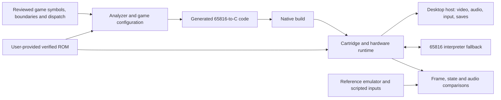

# Architecture plan

Status: proposed, 2026-10-28. The experimental native-dispatch and interpreter modes complete recorded first and second courses, reload their saves, and reach course three; known divergences and incomplete gates are recorded in [docs/compatibility.md](docs/compatibility.md). Research and source links: [docs/research.md](docs/research.md). Decisions below remain hypotheses until the gates pass.

## Goal and scope

Build a reproducible desktop recompilation of Kirby's Dream Course (USA), preserving original game behavior first. Translate the main 65816 CPU code to native C where analysis is sound, while retaining an interpreter for unresolved execution and a hardware runtime for the rest of the SNES. A playable program, accurate saves, and repeatable comparisons matter more than translation percentage. Start with Windows and design for portable C and CMake; add other hosts when tested. Enhancements are optional and follow baseline fidelity.

## Input identity

The local `Kirby's Dream Course (USA).sfc` is 1,048,576 bytes, SHA-256 `0f984dc5fe8293f75e3b8fad98b0cb564706d9b1e3902b56415aa399c2d4df2b`. Its bytes at $7FC0 contain the game title, map-mode byte $30 and cartridge-type byte $02, consistent with a headerless Fast LoROM, RAM and battery; verify mapper, SRAM capacity, vectors, checksum and any special hardware against the actual image and trusted cartridge documentation before implementation. This hash identifies this particular input, not proof of an authoritative revision or a clean dump. Record verified supported revisions explicitly; reject mismatches with a clear message and never silently strip headers or patch input. Keep ROMs and derived game content local.

## Proposed system

Evaluate [RetroPortingToolKit/snesrecomp](https://github.com/RetroPortingToolKit/snesrecomp) first: it supplies analysis, C generation, interpreter fallback and SNES runtime. Pin an exact tested commit and capture its tools and transitive dependencies; do not assume a particular upstream API or bootstrap command until inspected at that pin. Its PolyForm Noncommercial license is a material constraint; review it and all third-party notices before adopting or distributing. If unacceptable or incompatible, evaluate the separately maintained [sp00nznet/snesrecomp](https://github.com/sp00nznet/snesrecomp) (MIT, different API and workflow) or another compatible implementation. Do not mix the two projects' APIs or assume feature parity.

The game integration owns ROM identity, mapping assertions, analysis configuration, discovered symbols, generated-code build integration, reset/frame scheduling, and game-specific diagnostics. The framework owns CPU semantics, mapped bus, DMA, timing, PPU and SPC/APU; changes there should be generic and attributable. The host owns presentation, deterministic input, audio output, persistence and clocks. Generated C is disposable: correct configuration or generator, regenerate, and compare outputs rather than hand-editing it. Preserve runtime ROM access for data and fallback; no claim that graphics or sound hardware itself becomes native game code.

65816 analysis must track accumulator/index widths, bank and direct-page state, interrupts, indirect calls, jump tables and code reached dynamically. Unknown targets fall back to the interpreter; log them with ROM hash, address, CPU state and context. Use disassemblies as evidence only after checking their revision and license. Keep corrections reviewable and tied to observed behavior, not guessed code boundaries.

## Validation contract

Establish a reference emulator and exact version, identical ROM, initial SRAM/reset state and frame-numbered input recordings. Run the same scenario twice to check determinism before comparison. Compare milestones and selected CPU/WRAM, SRAM, PPU/framebuffer and audio observations with explicit alignment and tolerances; distinguish renderer/audio differences from game-state divergence. Capture first divergence, preceding inputs and diagnostics. A reference is an oracle to investigate, not automatically perfect; document known timing and hardware differences. Tests must cover translation and fallback transitions, width changes, interrupts, DMA, persistence and any hardware actually used by this game. Instrumentation must not change behavior.

## Milestones and exit gates

1. **Inventory:** verify local ROM identity and header, cartridge features, reference emulator and available game disassembly; record provenance and license. Gate: supported input and hardware assumptions are documented and independently checked.
2. **Framework spike:** select and pin a revision; build its tests and a minimal game integration on Windows. Gate: mapper and required hardware work, license constraints are accepted, and a deterministic headless ROM boot reaches a recorded milestone. If blocked, document the failure and evaluate the alternative before investing in translation.
3. **Baseline:** integrate generation, bus, timing and interpreter; establish reset, frame stepping, input, rendering, sound and SRAM. Gate: repeatable boot and attract-mode checkpoints compared with the reference, with all unresolved execution visible.
4. **Playability:** discover code and tables from evidence, refine translation and fix runtime differences. Gate: repeatable scripted title-to-course play, scoring, transitions, saving and fresh-process reload against reference checkpoints; document untested paths and fallback coverage.
5. **Release readiness:** extend scenarios through modes and game completion, validate audio/video and saves across supported hosts, package notices and ROM-free artifacts. Gate: documented coverage and remaining defects; no blanket completion claim without end-to-end evidence.
6. **Enhancements:** add optional features behind settings only after baseline scenarios pass with defaults. Compare default behavior after every enhancement.

## Proposed layout

`recomp/` for game analysis configuration and symbols; `src/` for integration and host code; `tools/` for repeatable generation and validation; `tests/` for small synthetic tests and ROM-dependent scenarios; `docs/` for research and decisions; `build/` and `generated/` for disposable output. Actual paths can follow the selected framework when integrated. Commit scripts, metadata and non-copyrighted fixtures; keep ROMs, extracted assets, generated game-derived output, saves and local recordings out of version control.

## Open decisions

The local ROM matches the independently catalogued size and SHA-1. Cartridge evidence and the bounded disassembly search are recorded in [inventory research](docs/inventory-research.md); the framework pin, reference emulator and current gaps are recorded in [compatibility](docs/compatibility.md). The framework's noncommercial license remains a distribution constraint, and its compatibility gate has not passed: game state still diverges from the reference. Frame and audio alignment, complete hardware behavior, translated-code coverage, and full-game playability remain open.
